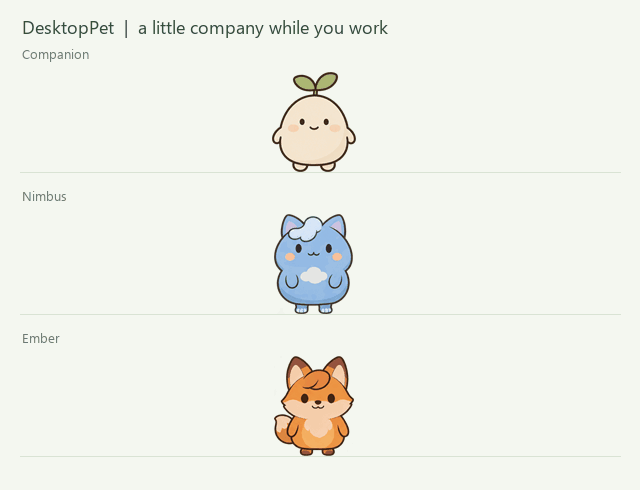

<div align="center">

# DesktopPet

AI 작업과 집중 시간에 조용히 함께하는 Windows 데스크톱 캐릭터.

[English](README.md) · **한국어** · [简体中文](README.zh-CN.md)

[릴리스](https://github.com/jinwovo/desktop-pet/releases) · [문제 신고](https://github.com/jinwovo/desktop-pet/issues/new/choose) · [기여 안내](CONTRIBUTING.md)




</div>

DesktopPet은 로컬 Claude Code·Codex의 응답 완료를 알려주고, 25분 집중·5분 휴식 타이머와 캐릭터 가져오기를 제공하는 바탕화면 펫입니다. 걷는 동안 캐시한 몸·발 그림을 연속으로 움직이고 실제 이동 거리에 보폭을 맞춥니다.

공용 캐릭터는 **Companion·Nimbus·Ember**입니다. 제작 방식과 원화 기록은 [공용 자산 제작 기록](docs/PUBLIC_ASSET_PROVENANCE.md)에 정리했습니다. 기존 프레임 방식의 사용자 스킨도 사용할 수 있습니다.

저장소에는 선택형 **치이카와·세균맨·헬로키티·폼폼푸린·시나모롤·쿠로미 팬아트 6종**도 [character-packs/fan-art](character-packs/fan-art/README.md)에 포함합니다. 오리지널 캐릭터와 구분하며 기존 캐릭터의 권리까지 MIT로 허가하는 것은 아닙니다. 기본 Windows ZIP에는 오리지널3종이 들어 있습니다. 선택형 팩은 설정의 캐릭터 추가로 가져오거나 `-p:PersonalBuild=true`로 빌드해 총9종을 사용할 수 있습니다.

## 빠른 시작

### 배포본 사용

1. [릴리스 페이지](https://github.com/jinwovo/desktop-pet/releases)를 엽니다. **실행 파일은 릴리스가 게시된 경우에만 다운로드할 수 있습니다.** 파일이 없다면 아래 소스 빌드를 사용하세요.
2. Windows x64 ZIP을 받아 **전체 압축을** 쓰기 가능한 폴더에 풀고 `DesktopPet.App.exe`를 실행합니다.
3. 첫 실행의 **AI 연결**에서 감지된 도구의 연결 상태를 확인합니다. 자동 등록되더라도 Codex 훅은 사용자가 직접 허용해야 합니다.
4. 트레이 아이콘을 두 번 눌러 **설정**을 엽니다. **테스트 알림**으로 AI 연결 없이 말풍선부터 확인할 수 있습니다.

기본 패키징은 .NET 런타임을 포함합니다. 이름에 `framework-dependent`가 표시된 별도 배포는 .NET 10 Desktop Runtime x64가 필요합니다. EXE·`Assets`·`Hooks` 폴더를 함께 유지하세요.

### 소스에서 실행

Windows와 **.NET 10 SDK**가 필요합니다.

```powershell
git clone https://github.com/jinwovo/desktop-pet.git
cd desktop-pet
dotnet restore DesktopPet.sln
dotnet build DesktopPet.sln -c Release --no-restore
.\src\DesktopPet.App\bin\Release\net10.0-windows\DesktopPet.App.exe
```

필요한 빌드·런타임 패키지가 없으면 NuGet에 접근할 수 있어야 합니다. 일반 사용자는 개발 SDK가 필요하지 않습니다.

## 주요 기능

| 기능 | 동작 |
| --- | --- |
| 공용 캐릭터 3종 | 설정에서 Companion·Nimbus·Ember를 선택합니다. |
| 접지 보행 | 실제 이동 거리와 화면 크기에 맞춰 몸과 발을 연속 이동하고, 멈추면 들린 발을 내린 뒤 쉽니다. |
| 조용한 완료 알림 | 기본 8초 동안 짧은 말풍선을 표시합니다. |
| 미확인 알림 보관 | 자동 닫힘은 삭제가 아닙니다. 트레이에서 다시 읽고 클릭해 확인합니다. |
| 집중 타이머 | 고정된 25분 집중·5분 휴식을 직접 제어합니다. |
| 캐릭터 추가 | `character.json`과 PNG가 들어 있는 개별 폴더를 가져옵니다. |
| 캐릭터 갤러리 | 한국어·영어 이름으로 검색하고 종류별로 좁힌 뒤 미리보기와 적용을 따로 실행합니다. |
| 방해 줄이기 | 숨김·방해 금지·크기·속도와 선택적 효과를 설정합니다. |

설명서는 영어·한국어·간체중국어로 제공합니다. 현재 앱 UI는 주로 **한국어**입니다. 빌드 대상은 Windows x64이며 macOS·Linux·네이티브 ARM64 패키지는 제공하지 않습니다.

## Claude Code·Codex 연결

트레이 메뉴나 설정의 **AI 연결**을 엽니다.

감지된 현재 사용자 프로필의 자동 연결은 기본으로 켜져 있습니다. DesktopPet의 Stop 훅만 추가·갱신하고 다른 설정과 훅은 보존합니다. 같은 화면에서 자동 연결을 끄거나 도구별 연결을 해제할 수 있습니다.

| 도구 | 사용자 설정 위치 | 적용 방법 |
| --- | --- | --- |
| Claude Code | `~/.claude/settings.json` 또는 `CLAUDE_CONFIG_DIR/settings.json` | 연결 후 Claude Code 세션을 다시 시작합니다. |
| 훅을 지원하는 로컬 Codex | `~/.codex/hooks.json` 또는 `CODEX_HOME/hooks.json` | 등록된 훅을 검토·신뢰합니다. |

**Codex 허용:** CLI 입력칸에 `/hooks`를 입력하거나, Codex 앱의 **Settings → Hooks** 또는 **Review hooks**를 엽니다. DesktopPet의 `Stop` 명령을 확인한 뒤 허용하세요. 훅 내용이 바뀌면 다시 검토해야 할 수 있으며, 프로그램이 사용자의 신뢰 결정을 대신 저장하지 않습니다. [Codex 공식 안내](https://learn.chatgpt.com/docs/hooks)

Claude Code는 연결 후 세션을 다시 시작하세요. [Claude Code 훅 문서](https://code.claude.com/docs/en/hooks)

알림의 완료는 **응답 턴 종료**를 뜻합니다. 프로젝트 전체나 테스트의 성공을 판정하지 않습니다. 웹 대화나 호환 로컬 훅이 없는 앱은 연동 대상이 아니며, 관리자가 정한 훅 비활성화 정책도 유지합니다.

## 집중 시간 관리

설정의 **집중 타이머** 카드에서 사용합니다.

1. **집중 시작**을 누르면 25분을 셉니다.
2. **일시정지 / 계속**으로 현재 시간을 멈추거나 이어갑니다.
3. **다시 시작**은 현재 세션을 처음부터 진행하고, **종료**는 완료 알림 없이 중단합니다.
4. 집중이 끝나면 **휴식 시작**으로 5분 휴식을 직접 시작합니다. 휴식 후 다음 집중도 직접 시작합니다.

세션을 자동 반복하거나 앱을 껐다 켰을 때 진행 중인 시간을 복구하지 않습니다. 완료 알림은 기존 로컬 inbox를 사용하고 숨김·방해 금지 설정을 따릅니다. 트레이에도 제어 메뉴가 있습니다.

## 알림이 방해되지 않게

- 자동으로 닫힌 말풍선은 미확인 목록에 남습니다.
- 연속 완료는 최신 내용을 보여주고, 미확인 목록은 도착 순서로 보관합니다.
- 숨겨둔 펫을 알림 때문에 다시 표시하지 않습니다.
- 숨기면 화면 그리기와 창 검색을 함께 멈춥니다. 다시 표시하면 백그라운드에서 최신 창 목록을 검색합니다. 숨겨도 알림 수신과 집중 타이머는 계속 동작합니다.
- **방해 금지** 중에는 자동 말풍선 없이 알림만 저장합니다.
- 창 사이 점프와 창 닫힘 연출은 기본으로 꺼져 있습니다. 창 닫힘 연출을 켜면 다른 앱의 창을 로컬에서 캡처하므로, 그 작업을 줄이려면 꺼두세요.

## 나만의 캐릭터 추가

1. 준비된 캐릭터 팩의 압축을 풉니다.
2. 설정에서 **캐릭터 추가**를 누릅니다.
3. `character.json`과 참조된 PNG가 있는 **개별 캐릭터 폴더**를 선택합니다.
4. 검사가 끝나면 사용자 보관 폴더로 복사하고 바로 선택합니다.

ZIP이나 그림 한 장을 직접 가져오는 기능은 아닙니다. 같은 이름의 폴더를 덮어쓰지 않으므로, 충돌하면 가져올 폴더의 이름을 바꾸세요. 수동으로 같은 이름의 사용자 폴더를 넣어도 기본 캐릭터가 우선합니다.

가져오기는 위험한 경로·링크를 차단하고 파일 수·원본 용량·디코딩 이미지 크기를 제한합니다. 기존 프레임 스킨과 선택적 6부품 `walkRig`를 지원합니다. 형식과 제작 검토 기준은 [캐릭터 팩 기여 안내](CONTRIBUTING.md#character-packs)를 참고하세요.

## 로컬 저장과 개인정보

알림과 집중 타이머는 로컬에서 동작합니다. 앱은 대화 내용을 업로드하거나 클라우드 동기화를 제공하지 않습니다.

| 데이터 | 위치 |
| --- | --- |
| 환경설정 | `%APPDATA%\DesktopPet\settings.json` |
| 미확인 알림 | `%LOCALAPPDATA%\DesktopPet\inbox\` |
| 추가 캐릭터 | `%LOCALAPPDATA%\DesktopPet\Characters\` |
| 연결된 프로필 경로 | `%LOCALAPPDATA%\DesktopPet\assistant-connections.json` |
| 단기 중복 억제 정보 | `inbox\.assistant-events\` |

AI 완료 알림에는 도구·작업 폴더 이름·시각·해시 식별자를 사용하며 응답 원문이나 transcript 내용은 저장하지 않습니다. Claude의 반복 알림 구분에는 transcript의 **파일 크기와 수정 시각**을 확인할 수 있습니다. 연결 기록과 설정 백업에는 로컬 경로가 있으므로, 이슈에 첨부하기 전에 가려주세요.

## 설치·업데이트·제거

압축을 푼 위치에서 바로 실행할 수 있습니다. 사용자별 고정 설치가 필요하면 배포본 안에서 실행합니다.

```powershell
powershell -NoProfile -File .\install.ps1
# Windows 로그인 시 자동 실행을 원하는 경우만:
powershell -NoProfile -File .\install.ps1 -AddToStartup
```

업데이트 전에 기존 펫을 종료하세요. 설치 프로그램은 payload를 검사하고 사용자 캐릭터·알림·연결 기록을 보존합니다. 설치 폴더의 `uninstall.ps1`은 도우미 연결 해제가 성공한 뒤 관리된 앱 파일을 제거합니다.

자동 업데이트 기능은 없습니다. 체크섬·폴더 이동·패키징·배포 검증은 [배포 안내](docs/DISTRIBUTION.md)에 있습니다.

## 개발과 검증

```powershell
dotnet build DesktopPet.sln -c Release
dotnet tests/DesktopPet.RegressionTests/bin/Release/net10.0-windows/DesktopPet.RegressionTests.dll
dotnet tests/DesktopPet.UiSmokeTests/bin/Release/net10.0-windows/DesktopPet.UiSmokeTests.dll --capture
powershell -NoProfile -File tests/assistant-hooks-regression.ps1
powershell -NoProfile -File tests/install-regression.ps1
powershell -NoProfile -File tests/package-regression.ps1
```

검사는 임시 폴더를 사용하며 실제 사용자 AI 설정에 훅을 등록하지 않습니다. Windows 링크 생성 권한이 없으면 해당 항목을 명시적으로 건너뜁니다. UI 검사는 실제 WPF 창을 생성하므로 렌더링과 측정 시간은 환경에 따라 다릅니다.

공용 Windows x64 배포를 만들려면 다음을 실행합니다.

```powershell
powershell -NoProfile -File scripts/package-release.ps1 -Version 0.8.0
```

`artifacts/releases/`에 self-contained ZIP과 SHA256을 만듭니다. 필요한 런타임 팩이 없으면 실패하며 배포 종류를 몰래 바꾸지 않습니다. [Windows 워크플로](.github/workflows/windows-release.yml)는 검사와 아티팩트 생성을 설정한 파일이며, 파일이 있다고 원격 빌드나 공개 릴리스가 성공했다는 뜻은 아닙니다.

## 자주 묻는 질문

**실행 중인데 보이지 않아요.** 트레이에서 펫 보이기를 켜고 크기·숨김 설정을 확인하세요.

**Codex에 연결됐다고 나오는데 알림이 없어요.** Codex에서 훅을 허용하고 활성 `CODEX_HOME`을 확인하세요. 정의가 안 보이면 로컬 세션을 다시 시작합니다. 테스트 알림으로 말풍선 문제와 훅 전달 문제를 구분할 수 있습니다.

**완료 말풍선이 사라졌어요.** 트레이의 미확인 알림 목록에 보관돼 있습니다. 숨김·방해 금지 중 알림도 그곳에서 확인합니다.

**캐릭터를 추가하지 못했어요.** 압축을 푼 개별 폴더, PNG 참조, `character.json`, 중복 이름을 확인하세요. 링크·손상된 설정·누락되거나 큰 이미지는 거부합니다.

**움직임이 무겁게 느껴져요.** 창 닫힘 연출을 끄고 캐릭터 크기를 줄여보세요. 문제를 신고할 때 Windows 버전·화면 배율·주사율·캐릭터 이름을 알려주세요. 모든 하드웨어에서 동일한 CPU 사용량이나 FPS를 보장하지 않습니다.

**앱을 다시 켜니 타이머가 멈췄어요.** 재실행하면 타이머는 대기 상태에서 시작합니다.

## 기여와 보안

[이슈](https://github.com/jinwovo/desktop-pet/issues)로 재현 가능한 문제, 번역 수정, 동작 예시를 보내주세요. [기여 안내](CONTRIBUTING.md), [보안 안내](SECURITY.md), [변경 기록](CHANGELOG.md)을 참고하세요.

[MIT 라이선스](LICENSE)로 공개합니다. AI를 보조 도구로 사용한 공용 캐릭터의 원화와 제작 과정은 [자산 출처](docs/PUBLIC_ASSET_PROVENANCE.md)에 기록했습니다.

## 캐릭터 만나기

| Companion | Nimbus | Ember |
| --- | --- | --- |
| 잎사귀가 돋은 포근한 크림색 새싹 친구 | 구름 앞머리와 작은 발을 가진 파란 고양이 | 크림색 꼬리 끝이 특징인 따뜻한 주황 여우 |


GIF는 실제 이동 기록으로 만든 미리보기이며 FPS 벤치마크가 아닙니다. 실제 펫·움직임 시험·설정 미리보기가 같은 연속 보행 렌더러를 사용합니다. [캐릭터 팩 안내](docs/CHARACTER_PACKS.md)에서 나만의 친구를 추가하는 방법을 확인하세요.

## 바꾸기 전에 갤러리에서 살펴보기

설정에서 새 캐릭터를 추가하면 열려 있는 갤러리도 갱신됩니다. 검색어·분류·선택한 카드는 유지하며, 이전 로딩 결과가 최신 목록을 덮지 않도록 처리합니다.

설정의 **갤러리 · 검색**에서 한국어·영어 이름이나 별칭으로 검색하고 오리지널·팬아트·사용자 캐릭터를 골라 볼 수 있습니다. 카드를 선택하면 정적 미리보기가 표시됩니다. **움직임 미리보기**는 별도 창에서 동작을 확인하고, **이 친구와 함께하기**를 눌러야 실제 펫이 바뀝니다. 검색과 미리보기만으로 현재 캐릭터가 바뀌지는 않습니다. 목록은 작은 썸네일만 읽고 움직임 미리보기는 선택한 캐릭터를 불러옵니다.

폼폼푸린·시나모롤·쿠로미는 [2026 산리오 캐릭터 대상 공식 결과](https://corporate.sanrio.co.jp/en/news/20260628_03.html)의 1위·2위·4위 캐릭터를 골라 추가했습니다. 이 저장소의 그림은 AI를 보조 도구로 사용한 팬아트입니다. 산리오 공식 이미지가 아니며, [제작 기록](character-packs/fan-art/POPULAR_ASSETS.md)에서 프롬프트와 재현 가능한 생성 과정을 확인할 수 있습니다.


## GitHub 공개 준비

[공개 배포 안내](docs/PUBLIC_RELEASE.md)에 개인용 자산을 제외한 소스 내보내기, GitHub 릴리스 초안 만들기, 현재 검증 범위와 저장소 소개·토픽 제안을 정리했습니다.

[다른 데스크톱 펫 비교·적용 검토](docs/REFERENCE_REVIEW.ko.md)에 6개 프로젝트의 소스 근거, 현재 코드에서 확인한 문제와 개선 우선순위를 정리했습니다. 검토 문서의 제안은 아직 구현한 기능으로 표시하지 않습니다.

앱 UI 전체 번역, 몸 방향 전환 개선, 키보드 접근성, 새 오리지널 캐릭터는 앞으로의 기여 주제입니다. 아직 구현한 기능으로 표시하지 않습니다. 유용하게 사용했다면 Star로 알려주세요. 재현 가능한 이슈와 작은 기여도 환영합니다.
