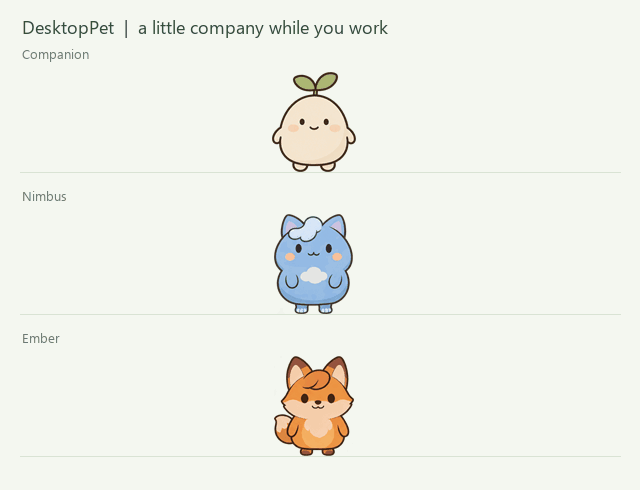
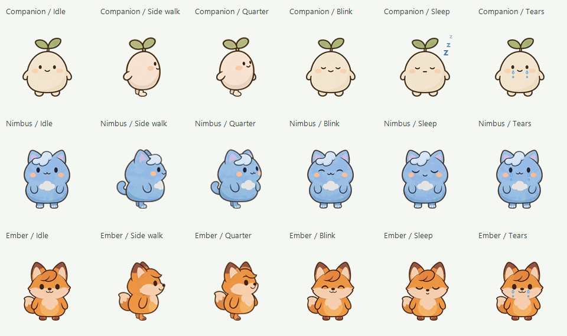
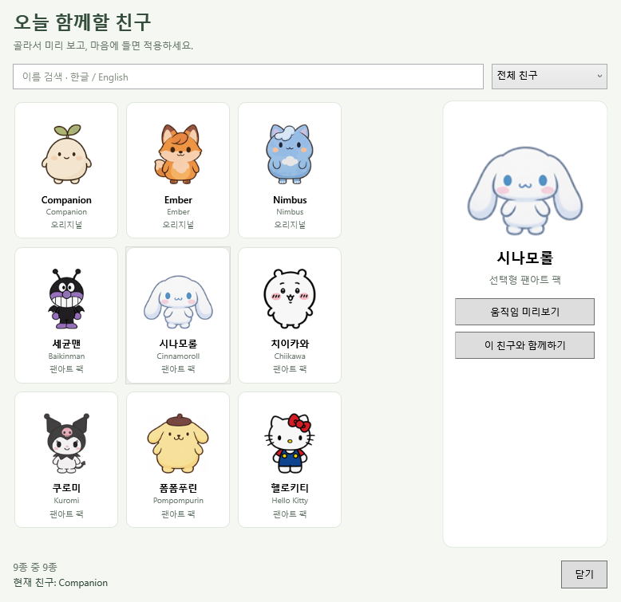
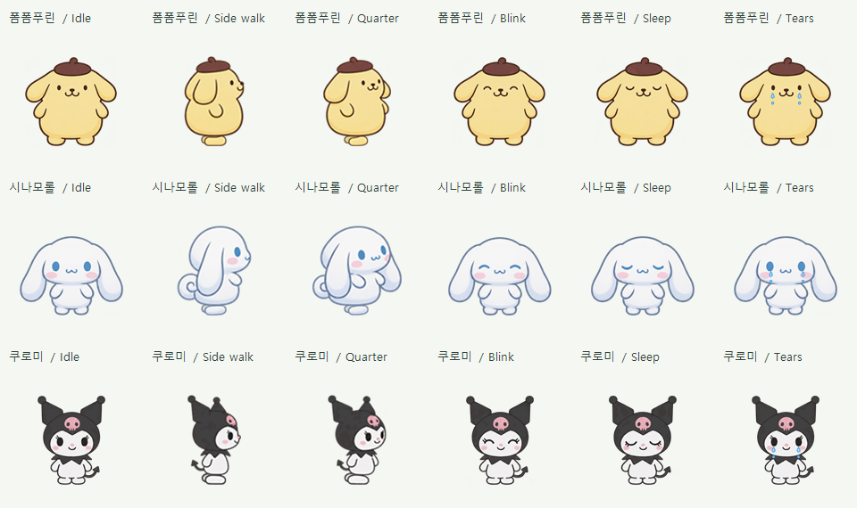

<div align="center">

# DesktopPet

A quiet desktop companion for AI work, focused sessions, and a less empty taskbar.

**English** · [한국어](README.ko.md) · [简体中文](README.zh-CN.md)

[Releases](https://github.com/jinwovo/desktop-pet/releases) · [Report a bug](https://github.com/jinwovo/desktop-pet/issues/new/choose) · [Contributing](CONTRIBUTING.md)




</div>

DesktopPet is a Windows desktop pet with gentle completion notifications for local Claude Code and Codex, a 25/5 focus timer, and importable character packs. Its live walking renderer moves cached body and foot layers continuously, using actual travel distance to keep a planted foot from sliding.

The public collection contains **Companion**, **Nimbus**, and **Ember**. Character creation and source records are documented in [Public asset provenance](docs/PUBLIC_ASSET_PROVENANCE.md). Existing frame-based custom packs remain supported.

The repository also includes six optional **Chiikawa, Baikinman, Hello Kitty, Pompompurin, Cinnamoroll and Kuromi fan-art packs** in [character-packs/fan-art](character-packs/fan-art/README.md). They are identified separately from the original collection and are not covered by the project's MIT grant for third-party character rights. The default Windows ZIP includes the three original characters; import optional packs through Settings or build with `-p:PersonalBuild=true` for all nine companions.

## Quick start

### Use a published build

1. Open [Releases](https://github.com/jinwovo/desktop-pet/releases). **Binary downloads are available only when a release has been published.** If the page has no release assets, use the source build below.
2. Download the Windows x64 ZIP, extract the **entire archive** into a writable folder, and run `DesktopPet.App.exe`.
3. Review the **AI connections** (`AI 연결`) screen. Detected local profiles can be registered automatically; Codex still requires your own hook approval.
4. Double-click the tray icon to open **Settings** (`설정`). Use **Test notification** (`테스트 알림`) to check the bubble without connecting an assistant.

The default release packaging includes its .NET runtime. An explicitly labelled `framework-dependent` package requires the .NET 10 Desktop Runtime x64. Keep the EXE, `Assets`, and `Hooks` together.

### Build from source

Windows and the **.NET 10 SDK** are required.

```powershell
git clone https://github.com/jinwovo/desktop-pet.git
cd desktop-pet
dotnet restore DesktopPet.sln
dotnet build DesktopPet.sln -c Release --no-restore
.\src\DesktopPet.App\bin\Release\net10.0-windows\DesktopPet.App.exe
```

NuGet access is needed for missing build or runtime packs. Runtime use does not require a developer SDK.

## What it does

| Feature | Behavior |
| --- | --- |
| Three public companions | Choose Companion, Nimbus, or Ember in Settings. |
| Grounded walking | Continuous body/foot transforms follow measured distance and sprite scale; raised feet settle before the resting pose. |
| Gentle completions | Short local bubbles; the default display duration is 8 seconds. |
| Unread inbox | Auto-hide retains a receipt. Review saved notifications from the tray and click to acknowledge them. |
| Focus timer | Default 25/5 sessions; configure focus 1–180 minutes and break 1–60 minutes. |
| Custom characters | Import a folder or ZIP; choose one character from collection archives without extracting them first. |
| Character gallery | Search Korean/English aliases, filter original/fan-art/custom packs, preview motion and apply explicitly. |
| Character personalities | Nimbus rests longer, Ember favors walks; authored packs can tune activity and sleep without altering gait. |
| Fullscreen cooperation | Temporarily pause on fullscreen, session lock and suspend; keep notifications and focus time. |
| Monitor geometry | Use both desktop coordinates for stacked/offset monitor landing and display-removal recovery. |
| Quiet controls | Hide the pet, enable Do not disturb, adjust size/speed, or disable optional effects. |
| Motion comfort | Choose a 30/60/120 FPS work cap and reduced motion; optional hops, nagging bounce, window capture and fades pause without changing saved effect choices. |
| Settings backup | Export/restore portable display, behavior and timer JSON. Assistant registration/trust and local paths stay on the current machine. |
| Local diagnostics | Preview and save a small JSON report for issues; no private paths, chat contents, keys or hook configuration. Settings also links to official releases for manual updates. |
| Recover a lost pet | Choose a monitor in Settings, or use **Bring pet here** in the tray for the pointer's nearest screen. Recovery preserves unread notifications and focus time. |

Settings and the tray support **Korean, English and Simplified Chinese**. Choose **Language** (`언어`) at the top of Settings; new profiles can follow Windows. Some advanced dialogs, error details and character-authored descriptions retain Korean. The build targets Windows x64; macOS, Linux, and native ARM64 packages are not provided.

## Connect Claude Code and Codex

Open the tray's **AI connections** (`AI 연결`) entry or the button in Settings.

Auto-connect is enabled by default for detected current-user profiles. DesktopPet adds or updates its own Stop handler, preserving unrelated settings and hooks. Disable auto-connect or disconnect an individual provider from the same screen.

| Provider | User configuration | Activation |
| --- | --- | --- |
| Claude Code | `~/.claude/settings.json`, or `CLAUDE_CONFIG_DIR/settings.json` | Restart the Claude Code session after registration. |
| Local Codex with hook support | `~/.codex/hooks.json`, or `CODEX_HOME/hooks.json` | Review and trust the registered hook. |

**Codex approval:** open `/hooks` in the Codex CLI, or **Settings → Hooks** / **Review hooks** in the Codex app. Find DesktopPet's `Stop` handler, review its command, and trust it. A changed hook definition may require a new review. DesktopPet does not create that trust for you. [Codex hook documentation](https://learn.chatgpt.com/docs/hooks)

Claude Code hook settings take effect according to its session configuration; restart the session after connecting. [Claude Code hook documentation](https://code.claude.com/docs/en/hooks)

A completion means an assistant's response turn ended. It does not certify that an entire project or test suite succeeded. Browser-only chats and applications without compatible local hooks are outside the integration. Administrator policies that disable hooks remain in effect.

## Focus without repeated interruptions

In Settings, open **Focus timer** (`집중 타이머`):

1. Choose **Start focus** (`집중 시작`) for 25 minutes.
2. **Pause / Continue** (`일시정지 / 계속`) suspends or resumes the current countdown.
3. **Restart** (`다시 시작`) starts the current session over. **Stop** (`종료`) ends it without a completion alert.
4. When focus finishes, start the 5-minute break explicitly. When the break finishes, start a new focus session when ready.

Use the minute fields and **시간 적용** to change durations. Changes preserve an active/paused countdown and apply on the next start or explicit restart. The timer does not automatically chain sessions or restore an active countdown after the app closes. Its completion uses the same local notification inbox, hidden-pet rules, and Do not disturb setting. Tray controls are also available.

## Notification controls

- Auto-hide closes a bubble without deleting it; the unread tray entry remains available.
- A burst shows the latest completion and retains unread receipts in arrival order.
- A hidden pet stays hidden when a notification arrives.
- Hiding pauses drawing and window-platform scanning. Showing the pet requests fresh platforms in the background; inbox delivery and the focus timer continue while hidden.
- **Pause during fullscreen** (`전체화면 앱을 사용할 때 잠시 숨기기`) is enabled by default. A foreground window covering the pet's monitor temporarily pauses presentation and optional capture. Session lock/suspend also pause presentation; resuming preserves your manual hidden preference. Other monitors' fullscreen windows do not hide the pet.
- **Do not disturb** (`방해 금지`) saves notifications without automatic bubbles.
- **Scheduled quiet hours** (`매일 예약 방해 금지`) accepts local `HH:mm` start/end times, including midnight crossing. Apply with `예약 적용`. Equal times are inactive. The schedule preserves manual quiet mode, retains receipts and permits explicit review; its end does not replay old alerts.
- Window hopping and the window-fall effect are off by default. The latter captures other application windows locally while enabled; leave it off to avoid that capture workload.

## Add your own character

1. Download a prepared character pack ZIP or prepare a folder with `character.json` and its PNGs.
2. In Settings, choose **Add ZIP** (`ZIP 추가`) for an archive, or **Add character** (`캐릭터 추가`) for an extracted folder.
3. For a collection ZIP, select the character to install and confirm. Only that pack is installed; repeat to add another.
4. DesktopPet validates all referenced PNGs, installs into your user library, selects the character and refreshes an open gallery.

ZIPs can contain `character.json` at the root, a wrapped character folder, or several character folders. Standalone pictures are not character packs. Existing names are never overwritten; use a new folder name (or manifest `name` for a root ZIP). Settings shows progress and a **Cancel installation** button. Cancellation or closing Settings stops unpublished work and cleans staging; if installation already committed, the pack stays installed and your current pet is retained. Cancelling collection selection changes nothing.

Imports reject unsafe paths, links, duplicate ZIP entries and conflicting names. ZIPs are limited to 64 MiB compressed, 256 MiB declared expanded data and 2,048 entries; each selected pack remains limited to 256 files, 64 MiB source and 64 MiB decoded image data. Legacy sprite cycles work alongside optional six-texture `walkRig` packs and per-character `behavior` profiles. See the [pack authoring guide](docs/CHARACTER_PACKS.md) and [contribution requirements](CONTRIBUTING.md#character-packs).

## Local storage and privacy

DesktopPet's notifications and focus timer run locally. The app does not upload chat content or provide cloud synchronization.

| Data | Location |
| --- | --- |
| Preferences | `%APPDATA%\DesktopPet\settings.json` |
| Unread notifications | `%LOCALAPPDATA%\DesktopPet\inbox\` |
| Additional characters | `%LOCALAPPDATA%\DesktopPet\Characters\` |
| Connected profile paths | `%LOCALAPPDATA%\DesktopPet\assistant-connections.json` |
| Short-lived deduplication claims | `inbox\.assistant-events\` |

Assistant notifications keep the provider, project-folder name, time, and hashed event identifiers. They do not save the assistant's message text or transcript contents. Claude replay detection can inspect transcript **file size and modification time**. Connection records and configuration backups can contain local paths; redact these before attaching files to an issue.

## Install, update, or remove

Portable use needs no installation script. For a per-user installation, run `install.ps1` from an extracted release:

```powershell
powershell -NoProfile -File .\install.ps1
# Optional: start after Windows sign-in.
powershell -NoProfile -File .\install.ps1 -AddToStartup
```

Close the existing pet before updating. The installer validates the payload and preserves user characters, notifications, and connection records. To remove an installed copy, close the pet from its tray and run its `uninstall.ps1`; assistant disconnection must succeed before managed app files are removed.

There is no built-in automatic updater. See [Distribution guide](docs/DISTRIBUTION.md) for checksums, portable moves, packaging, and release validation.

## Development and verification

```powershell
dotnet build DesktopPet.sln -c Release
dotnet tests/DesktopPet.RegressionTests/bin/Release/net10.0-windows/DesktopPet.RegressionTests.dll
dotnet tests/DesktopPet.UiSmokeTests/bin/Release/net10.0-windows/DesktopPet.UiSmokeTests.dll --capture
powershell -NoProfile -File tests/assistant-hooks-regression.ps1
powershell -NoProfile -File tests/install-regression.ps1
powershell -NoProfile -File tests/package-regression.ps1
```

The suites use fixture directories and do not register hooks in your real assistant configuration. Symbolic-link cases explicitly skip when the required Windows privilege is unavailable. UI checks create actual WPF windows; rendering results and timing depend on the machine.

To create a public Windows x64 package:

```powershell
powershell -NoProfile -File scripts/package-release.ps1 -Version 0.90.0
```

The output is a self-contained ZIP and a SHA256 sidecar under `artifacts/releases/`. Missing runtime packs cause a build failure; the script does not silently change deployment type. The [Windows workflow](.github/workflows/windows-release.yml) is configured to run checks and create artifacts; its presence does not imply a successful remote build or a published release.

## FAQ

**The pet is running, but I cannot see it.** Open the tray menu and enable pet visibility. Check Settings for a previous scale or hidden preference.

**Codex appears connected but sends no completion.** Review the hook in Codex, check the active `CODEX_HOME`, and restart the local session if the new definition is not listed. Use Test notification to separate bubble visibility from hook delivery.

**A completion disappeared.** Auto-hide retains it. Open the tray's unread-notification entry. Hidden and Do not disturb modes also keep it there.

**My character does not import.** Select its extracted folder, check referenced PNGs and `character.json`, and use a unique folder name. Links, missing or oversized resources, and malformed metadata are rejected.

**The motion feels heavy.** Keep the window-fall effect disabled, reduce character size, and compare on one monitor before reporting the Windows version, display scale, refresh rate, and character name. No hardware-independent CPU or frame-rate guarantee is made.

**The timer stopped after reopening DesktopPet.** Timer sessions intentionally start idle after relaunch.

## Contributing and security

Bug reports, language corrections, and reproducible animation examples are welcome in [Issues](https://github.com/jinwovo/desktop-pet/issues). Please read [CONTRIBUTING.md](CONTRIBUTING.md), [SECURITY.md](SECURITY.md), and [CHANGELOG.md](CHANGELOG.md).

Released under the [MIT license](LICENSE). AI-assisted public artwork and generation steps are documented in [Public asset provenance](docs/PUBLIC_ASSET_PROVENANCE.md).

## Meet your companions

| Companion | Nimbus | Ember |
| --- | --- | --- |
| A soft cream seedling with a leaf sprout. | A cloud-blue cat with a cloud tuft and little paws. | A warm orange fox with a cream-tipped tail. |



The GIF is a recorded movement preview, not an FPS benchmark. The desktop pet, motion tester and Settings preview share the live renderer. [Character pack guide](docs/CHARACTER_PACKS.md) explains how to add your own original companion.

## Public release preparation

See [Public release guide](docs/PUBLIC_RELEASE.md) for a clean source export, draft GitHub release workflow, validation status and suggested repository description/topics. The exporter excludes local assistant configurations and unselected private development artwork. The six explicitly selected fan-art packs have their own notice and directory.

[Desktop-pet reference review (Korean)](docs/REFERENCE_REVIEW.ko.md) compares six projects at source level, identifies current gaps and records proposed improvements and reuse constraints. Proposed features in that review are not shipped behavior.

Developers can optionally use the [NVIDIA work helper](docs/NVIDIA_WORK.md) for explicit code-review prompts with four-model fallback. This is a separate development tool; desktop app users do not need API credentials.

## Browse before switching

Importing through Settings refreshes an already-open gallery while keeping its search, category and selected card. Obsolete loads are cancelled so older results cannot replace the latest collection.

Open Settings → **갤러리 · 검색** (Gallery / search). Type a Korean or English name, narrow the collection, and select a card. **움직임 미리보기** opens a separate motion preview; **이 친구와 함께하기** applies the selection. Searching and previewing do not change your active pet. Only card thumbnails are decoded for the grid; a motion preview loads the selected character.

Pompompurin, Cinnamoroll and Kuromi were selected from the official [2026 Sanrio ranking](https://corporate.sanrio.co.jp/en/news/20260628_03.html), where they placed first, second and fourth. The artwork here is AI-assisted fan art, not official Sanrio assets. [Creation records](character-packs/fan-art/POPULAR_ASSETS.md) include the prompts and reproducible generator.





Planned contribution areas include full UI localization, smoother body-angle transitions, keyboard accessibility and more original character packs. These are ideas, not shipped features. If DesktopPet is useful to you, a star helps others discover it; reproducible issues and small contributions are equally welcome.
