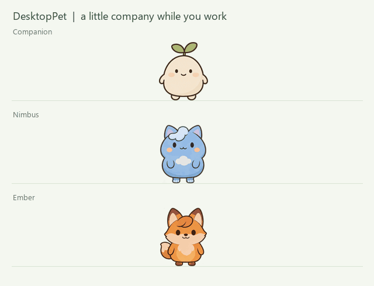
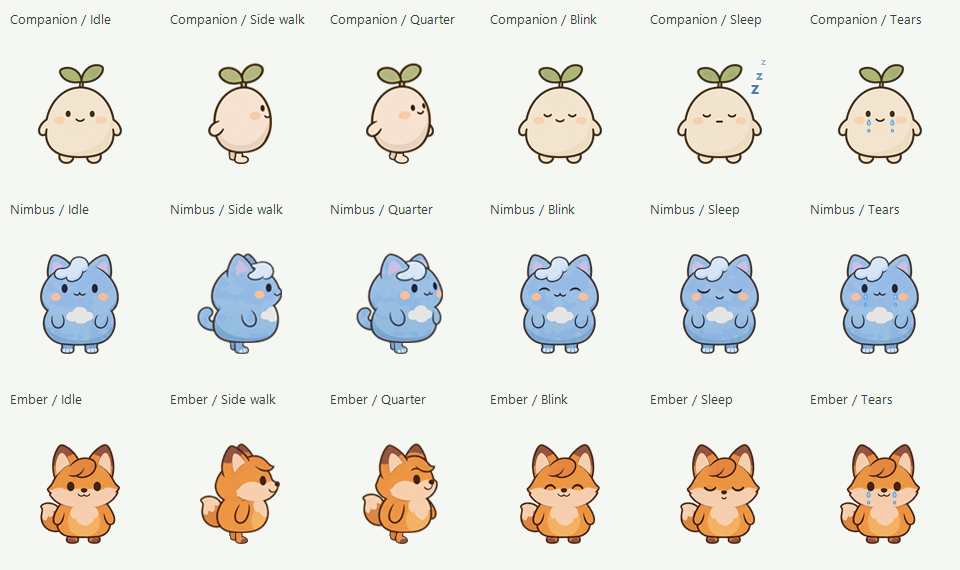
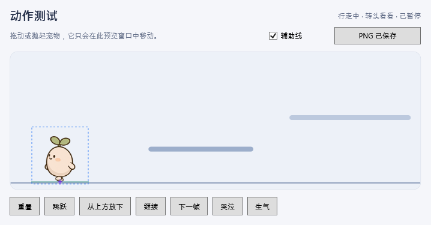
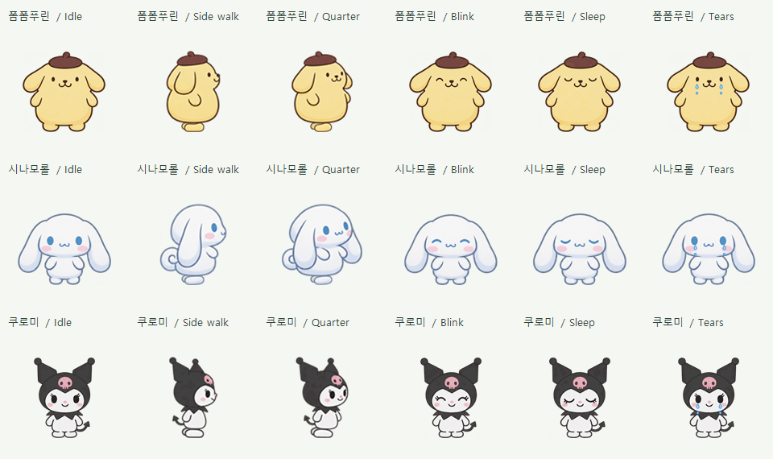

<div align="center">

# DesktopPet

陪伴 AI 工作与专注时间的安静 Windows 桌面宠物。

[English](README.md) · [한국어](README.ko.md) · **简体中文**

[版本发布](https://github.com/jinwovo/desktop-pet/releases) · [报告问题](https://github.com/jinwovo/desktop-pet/issues/new/choose) · [参与贡献](CONTRIBUTING.md)




</div>

[2.0 路线图与 100 次改进进度](docs/ROADMAP_2_0.md)

1.4.0 累计包含 40 项经过验证的改进，新增当前阶段延时与专注次数、保留草稿的设置、通知搜索和来源筛选、确认选定通知、本地 JSON 导出以及暂停通知 15 分钟。

DesktopPet 可以提醒本地 Claude Code、Codex 的回复完成，提供 25 分钟专注 / 5 分钟休息计时器，并支持导入角色包。行走时使用缓存的身体与双脚图层连续运动，根据实际移动距离调整步态，减少脚踩地时的滑动。

1.0.2 保留头部、躯干和双脚的独立运动，将身体左右转向平滑到 120 毫秒，并在 100 毫秒内完成侧面与斜侧面的过渡。九个内置角色的步行速度提高约 20%，抬脚高度降低。现有六贴图角色包无需修改，减少动态效果会关闭关节运动与淡入淡出。

公开角色包括 **Companion、Nimbus 和 Ember**。制作方式与素材来源见[公开素材记录](docs/PUBLIC_ASSET_PROVENANCE.md)。已有的逐帧角色包也可继续使用。

仓库也在 [character-packs/fan-art](character-packs/fan-art/README.md) 中提供可选的 **Chiikawa、Baikinman、Hello Kitty、Pompompurin（布丁狗）、Cinnamoroll（大耳狗）和 Kuromi（酷洛米）六款同人角色包**。它们与原创角色分开标注，项目 MIT 许可不授予第三方角色权利。默认 Windows ZIP 包含三款原创角色；可在设置中导入可选包，或使用 `-p:PersonalBuild=true` 构建全部九款角色。

## 快速开始

### 使用发布包

1. 打开[版本发布页面](https://github.com/jinwovo/desktop-pet/releases)。**只有维护者发布版本后才会提供二进制下载。** 如果没有发布文件，请按下方步骤从源码构建。
2. 下载 Windows x64 ZIP，将**完整压缩包**解压到可写文件夹，运行 `DesktopPet.App.exe`。
3. 查看首次启动的 **AI 连接**（`AI 연결`）窗口。检测到的本地配置可以自动注册；Codex 的钩子仍需本人授权。
4. 双击托盘图标打开**设置**（`설정`）。先点击**测试通知**（`테스트 알림`），无需连接 AI 即可检查气泡。

默认打包方式包含 .NET 运行时。文件名明确标有 `framework-dependent` 的包需要另行安装 .NET 10 Desktop Runtime x64。请保留 EXE、`Assets` 和 `Hooks` 的完整目录结构。

### 从源码运行

需要 Windows 和 **.NET 10 SDK**。

```powershell
git clone https://github.com/jinwovo/desktop-pet.git
cd desktop-pet
dotnet restore DesktopPet.sln
dotnet build DesktopPet.sln -c Release --no-restore
.\src\DesktopPet.App\bin\Release\net10.0-windows\DesktopPet.App.exe
```

缺少构建或运行时包时，需要能够访问 NuGet。普通使用者不需要安装开发 SDK。

## 主要功能

| 功能 | 行为 |
| --- | --- |
| 右键点击宠物 | 打开与托盘相同的操作菜单。 |
| 暂停自动散步 | 本次运行中暂停自动走动与跳跃，宠物仍可见，拖动与下落不受影响。 |
| 复制 | 复制标题和原始正文，通知保持未读。 |
| 全部标为已读 | 批量处理已有通知，新到达与处理失败的通知继续保留。 |
| 三个公开角色 | 在设置中选择 Companion、Nimbus 或 Ember。 |
| 脚部接地行走 | 身体与双脚按实际距离和显示大小连续移动，停止时先放下抬起的脚。 |
| 轻柔完成提醒 | 默认显示 8 秒的简短气泡。 |
| 未读通知 | 自动隐藏不等于删除；可从托盘重新查看并点击确认。 |
| 专注计时器 | 默认 25/5 分钟；可设专注 1–180 分钟、休息 1–60 分钟。 |
| 导入角色 | 支持文件夹和 ZIP；合集 ZIP 可以直接选择一个角色安装。 |
| 角色画廊 | 按韩语、英语名称或别名搜索，按类别筛选，分别预览和应用角色。 |
| 角色性格 | Nimbus 更喜欢休息，Ember 更喜欢走动；角色包可设置活动、休息和睡眠倾向。 |
| 全屏配合 | 全屏、锁屏和休眠时暂时隐藏，保留通知及专注计时。 |
| 多屏几何 | 同时使用 X/Y 坐标处理上下、错位屏幕的落地和移除屏幕后的恢复。 |
| 减少打扰 | 可隐藏宠物、开启免打扰、调整大小和速度、关闭可选效果。 |
| 动效设置 | 可设 30/60/120 FPS 工作上限；减少动效会抑制自动跳跃、强提醒、窗口捕获和淡入淡出，保留原有特效偏好。 |
| 设置备份 | 导出/恢复显示、行为和计时 JSON；助手注册、钩子信任及本地路径保留在当前机器。 |
| 本地诊断 | 预览并保存版本、渲染状态 JSON，不含私人路径、对话、密钥或钩子配置；通过官方版本链接手动更新。 |
| 恢复宠物位置 | 在设置中选择屏幕，或使用托盘的 **Bring pet here** 移到鼠标附近的屏幕，保留未读通知与专注时间。 |

设置顶部的**语言**（`언어`）支持韩语、英语和简体中文，覆盖设置、托盘及主要状态信息。新配置可跟随 Windows 语言。部分高级窗口、错误详情及角色作者描述仍为韩语。构建目标为 Windows x64；不提供 macOS、Linux 或原生 ARM64 安装包。

## 连接 Claude Code 和 Codex

从托盘菜单或设置打开 **AI 连接**（`AI 연결`）。

默认会为检测到的当前用户配置尝试自动连接。DesktopPet 只添加或更新自己的 Stop 处理器，保留其他配置和钩子。可在同一窗口关闭自动连接或断开某个工具。

| 工具 | 用户配置位置 | 生效方式 |
| --- | --- | --- |
| Claude Code | `~/.claude/settings.json` 或 `CLAUDE_CONFIG_DIR/settings.json` | 注册后重启 Claude Code 会话。 |
| 支持钩子的本地 Codex | `~/.codex/hooks.json` 或 `CODEX_HOME/hooks.json` | 检查并信任已注册的钩子。 |

**Codex 授权：**在 CLI 输入 `/hooks`，或打开 Codex 应用的 **Settings → Hooks** / **Review hooks**。找到 DesktopPet 的 `Stop` 命令，检查后允许执行。定义改变后可能需要重新审核；DesktopPet 不会代替用户写入信任决定。[Codex 官方说明](https://learn.chatgpt.com/docs/hooks)

连接 Claude Code 后，请重新开始会话。[Claude Code 钩子文档](https://code.claude.com/docs/en/hooks)

“完成”表示一次**回复轮次结束**，不代表整个项目或测试套件成功。不支持浏览器聊天或没有兼容本地钩子的应用；管理员禁止钩子的策略仍然有效。

## 管理专注时间

在设置的**专注计时器**（`집중 타이머`）卡片中操作：

1. **开始专注**（`집중 시작`）启动 25 分钟倒计时。
2. **暂停 / 继续**（`일시정지 / 계속`）暂停或恢复当前倒计时。
3. **重新开始**（`다시 시작`）重置当前阶段；**停止**（`종료`）结束计时，不发送完成提醒。
4. 专注结束后，手动点击**开始休息**（`휴식 시작`）进行 5 分钟休息。休息结束后再手动开始下一次专注。

在分钟输入框修改后点击 **시간 적용**。运行或暂停中的剩余时间保持不变，下次启动或主动重新开始时采用新时长。不会自动连续循环，也不会在关闭程序后恢复正在进行的计时。计时完成使用同一个本地通知收件箱，遵守隐藏与免打扰设置。托盘菜单也提供控制入口。

**1.4.0：**在设置或托盘/宠物菜单使用 **增加 5 分钟**，仅延长当前运行或暂停的专注/休息阶段。暂停状态与默认时长保持不变，重新开始时使用配置的默认值。已结束的阶段只完成一次，迟来的点击不会重新激活它；每个阶段的总运行时间上限为 24 小时。

1.4.0还显示本次运行的**已完成专注次数**。在设置或托盘/宠物菜单点击**重置次数**只清除计数，保留当前倒计时、临时增加的时间及未读通知。休息不计入次数，退出应用后不保存此计数。

1.4.0切换设置语言时会保留尚未应用的时长、免打扰时段与启用选项，并翻译最近的校验或应用结果提示。仍需主动点击应用；有效的备份恢复会替换草稿并清除旧提示。

1.4.0还提供 **25 / 5**、**50 / 10** 快捷填写按钮，只填写专注/休息分钟数。点击**应用时长**才会修改后续默认值，当前运行或暂停的阶段及临时增加的时间保持不变。

## 键盘与辅助功能（1.5.0 开发版）

**1.5.0 开发版：**设置输入项的名称与时长/时间格式说明通过 Windows 辅助功能元数据提供三种语言支持，切换语言会保留尚未应用的编辑。此改进尚未包含在 1.4.0 下载中。

同一开发版通知列表支持 **Ctrl+S** 导出当前结果 JSON、**Ctrl+Shift+R** 仅确认选定通知、**Ctrl+L** 清除筛选。忙碌、无结果或已关闭窗口会阻止不可用操作，并保留原有查找、Escape 和正常 Delete 文本编辑。

在时长或免打扰时间输入框中按 **Enter** 应用当前草稿。无效值会保留设置窗口并显示原有校验提示，正在进行的专注倒计时保持不变。

在设置中按 **Ctrl+1~4** 可跳转至角色、大小/速度、专注或通知设置，自动滚动并聚焦目标，不会应用正在编辑的值。

滚动设置正文时，动作测试、AI 连接、关闭及区段跳转提示始终固定在底部，小窗口也不必滚到底部寻找按钮。关闭不会应用尚未确认的时间编辑。

画廊也通过 Windows 辅助功能元数据提供本地化的搜索、类别、列表名称及使用说明。卡片保留原始角色名与 Unicode 自定义名称，类别说明则使用当前界面语言。

## 通知与免打扰

- **暂停通知 15 分钟** 仅暂时关闭自动气泡，未读通知继续保存，专注计时器保持运行。**恢复暂停的通知** 只取消临时暂停，手动及每日免打扰保持不变。到期或恢复不会重播已保存气泡；关闭应用后临时暂停清除。
- **1.4.0：**从托盘或宠物菜单打开 **通知列表...**，隐藏宠物时也能查看已保存通知。选择条目不会标为已读，可选择并复制原文。列表显示来源与本地时间，新通知到达后保留当前选择。
- 通知列表可搜索标题、正文与来源，并按 Claude、Codex、专注计时器、测试或其他来源筛选。**Ctrl+F** 聚焦搜索框；**清除筛选**或 **Escape** 清除搜索词和来源筛选。切换语言会保留原始输入与筛选条件，同时显示匹配数与保存总数。
- 点击 **将选定通知标记为已读** 才会确认该条通知，其他通知和新到通知继续保留。删除失败时可 **重试标为已读**。处理期间更换选择或关闭列表，不会改变最初请求处理的目标。
- **导出当前通知 JSON** 将当前搜索/筛选结果的原始标题、正文、来源和创建时间保存到您选择的本地文件，不改变已读状态，也不上传云端。保留已有文件，可用新文件名重试；关闭列表会取消未完成的保存。
- 气泡自动消失后，未读记录仍然保留。
- 连续通知显示最新内容，未读列表按到达顺序保存。
- 收到通知不会自动显示已隐藏的宠物。
- 默认开启全屏暂时隐藏（`전체화면 앱을 사용할 때 잠시 숨기기`）。只判断宠物所在屏幕的前台窗口；锁屏与休眠也会暂停显示及可选捕获，恢复后保留手动隐藏设置。
- **免打扰**（`방해 금지`）只保存通知，不自动弹出气泡。
- **每日预约免打扰**（`매일 예약 방해 금지`）支持本地 `HH:mm` 和跨午夜时段，点击 `예약 적용` 生效。起止相同则不启用时段。保留手动免打扰及未读记录；时段结束不会重播旧气泡，可主动查看未读通知。
- 窗口跳跃和窗口关闭下落效果默认关闭。开启后者时会在本机捕获其他应用窗口；关闭它可避免这部分捕获工作。

## 添加自己的角色

1. 下载角色 ZIP，或准备包含 `character.json` 与 PNG 的文件夹。
2. 在设置中点击 **ZIP 추가** 导入 ZIP；已解压的文件夹仍使用 **캐릭터 추가**。
3. 合集 ZIP 会显示选择窗口，确认后只安装所选角色。需要其他角色时可再次选择该 ZIP。
4. 全部引用 PNG 验证通过后，程序安装并应用角色，同时刷新已打开的画廊。

ZIP 支持根目录、嵌套角色文件夹或多个角色文件夹。单张图片不能直接作为角色包。同名角色不会被覆盖；请修改角色文件夹名称，根目录 ZIP 使用清单中的 `name`。安装显示进度和**取消安装**按钮；取消或关闭设置会停止未提交的工作并清理临时文件。如果安装已提交，角色包会保留在库中，当前宠物保持不变。

拒绝危险路径、链接及重复 ZIP 路径。ZIP 限制为压缩大小 64 MiB、声明的解压总量 256 MiB、2,048 个条目；单个角色仍限制为 256 个文件、64 MiB 源文件和 64 MiB 解码图像。支持传统逐帧皮肤、可选六贴图 `walkRig` 和 `behavior` 性格配置。参见[角色包格式](docs/CHARACTER_PACKS.md)及[贡献要求](CONTRIBUTING.md#character-packs)。

## 本地存储与隐私

使用 `DesktopPet.App.exe --check-install` 可只读检查资源。角色及钩子桥接资源有效时返回 JSON 和退出码 0，无效时返回 2；不会显示宠物、注册钩子或加载用户偏好。下载文件的完整性仍需另行比较 SHA256。

通知与专注计时器在本机运行。程序不上传聊天内容，也不提供云端同步。

| 数据 | 位置 |
| --- | --- |
| 偏好设置 | `%APPDATA%\DesktopPet\settings.json` |
| 未读通知 | `%LOCALAPPDATA%\DesktopPet\inbox\` |
| 添加的角色 | `%LOCALAPPDATA%\DesktopPet\Characters\` |
| 已连接配置的路径 | `%LOCALAPPDATA%\DesktopPet\assistant-connections.json` |
| 短期去重标记 | `inbox\.assistant-events\` |

AI 通知使用工具名称、项目文件夹名称、时间和哈希标识，不保存回复原文或 transcript 内容。Claude 去重可能检查 transcript 的**文件大小和修改时间**。连接记录与配置备份可能包含本地路径，提交问题时请先遮盖这些信息。

## 安装、更新和卸载

可以直接使用解压后的便携目录。需要固定安装到当前用户目录时，在发布包中运行：

```powershell
powershell -NoProfile -File .\install.ps1
# 仅在需要登录 Windows 后自动启动时使用：
powershell -NoProfile -File .\install.ps1 -AddToStartup
```

更新前请从托盘退出旧程序。安装脚本验证文件并保留用户角色、通知和连接记录。安装目录中的 `uninstall.ps1` 会先断开助手连接，成功后才删除受管理的程序文件。

程序没有内置自动更新器。校验和、移动便携目录、打包和发布验证见[分发指南](docs/DISTRIBUTION.md)。

## 开发与验证

```powershell
dotnet build DesktopPet.sln -c Release
dotnet tests/DesktopPet.RegressionTests/bin/Release/net10.0-windows/DesktopPet.RegressionTests.dll
dotnet tests/DesktopPet.UiSmokeTests/bin/Release/net10.0-windows/DesktopPet.UiSmokeTests.dll --capture
powershell -NoProfile -File tests/assistant-hooks-regression.ps1
powershell -NoProfile -File tests/install-regression.ps1
powershell -NoProfile -File tests/package-regression.ps1
```

测试使用临时目录，不会向真实助手配置注册钩子。没有 Windows 符号链接权限时，相关测试会明确跳过。UI 测试会创建真实 WPF 窗口，渲染和耗时受机器环境影响。

构建公开 Windows x64 包：

```powershell
powershell -NoProfile -File scripts/package-release.ps1 -Version 1.4.0
```

输出位于 `artifacts/releases/`，包含 self-contained ZIP 与 SHA256 文件。缺少运行时包时构建会失败，不会静默切换为其他部署方式。[Windows 工作流](.github/workflows/windows-release.yml)配置了测试与构建产物；存在该文件不等于远程构建已通过或版本已经发布。

## 常见问题

**程序在运行，却看不到宠物。** 从托盘打开显示选项，并检查大小和隐藏设置。

**Codex 显示已连接，却没有通知。** 在 Codex 审核钩子，检查活动的 `CODEX_HOME`。未显示新定义时重新打开本地会话。可先用测试通知确认气泡是否可见。

**完成气泡消失了。** 从托盘的未读通知列表重新查看。隐藏和免打扰期间收到的通知也保存在那里。

**角色导入失败。** 检查解压后的单独文件夹、PNG 引用、`character.json` 和重名情况。链接、缺失或超大图片、损坏元数据会被拒绝。

**动画感觉卡顿或占用较高。** 关闭窗口下落效果，减小角色显示大小。报告问题时提供 Windows 版本、显示缩放、刷新率和角色名称。程序不保证所有硬件上具有相同 CPU 占用或帧率。

**重新打开程序后计时器没有继续。** 重新启动程序时，计时器按设计回到待机状态。

## 贡献与安全

欢迎通过[问题页面](https://github.com/jinwovo/desktop-pet/issues)提交可复现的问题、翻译修正和动画示例。请阅读[贡献指南](CONTRIBUTING.md)、[安全说明](SECURITY.md)和[变更记录](CHANGELOG.md)。

本项目采用 [MIT 许可证](LICENSE)。公共角色使用 AI 辅助制作，原始素材和制作流程记录在[素材来源](docs/PUBLIC_ASSET_PROVENANCE.md)中。

## 认识伙伴

| Companion | Nimbus | Ember |
| --- | --- | --- |
| 头顶嫩叶、奶油色的温柔种子伙伴 | 带有云朵刘海和小爪子的蓝色猫咪 | 尾尖为奶油色的暖橙色小狐狸 |



GIF 根据实际移动记录生成，并非帧率基准测试。桌面宠物、动作测试窗口和设置预览共用连续步态渲染器。阅读[角色包指南](docs/CHARACTER_PACKS.md)，了解如何添加原创伙伴。

## 切换前先浏览角色

打开设置中的 **갤러리 · 검색**（画廊 / 搜索），输入韩语、英语名称或别名，并按原创、同人或自定义角色筛选。选择卡片后会显示静态预览。**움직임 미리보기**（动作预览）在单独窗口中展示动作；只有点击 **이 친구와 함께하기**（使用这位伙伴）才会切换桌面宠物。搜索和预览不会改变当前角色。列表只解码小缩略图，动作预览只加载所选角色。

**角色导出（1.3.0）：**选择卡片后点击 **导出 ZIP** 即可分享角色包。请选择角色文件夹外的新 ZIP 文件名，已有文件不会被覆盖。导出会先验证副本，仅保存 `character.json` 及其引用的 PNG；可点击 **取消导出** 或关闭画廊中止。当前宠物保持不变，接收者通过普通 ZIP 导入安装。详见[角色包指南](docs/CHARACTER_PACKS.md#export-a-character-zip)。

1.3.0 动作预览还新增 **暂停 / 继续** 和 **下一帧**。按所选 30/60/120 FPS 逐帧查看行走、下落和姿态过渡。隐藏或最小化后仍保持暂停；暂停时点击 **重置** 会重新布置场景并保持暂停。桌面宠物仍独立运行。

在同一窗口使用 **哭泣·生气** 可直接检查表情帧和眼泪。拖拽或抛掷途中请求的表情会等到落地后播放，最后一次请求优先，顶部会显示待播放表情。这些操作仅影响预览。

**保存场景 PNG** 会在打开保存对话框前记录当前预览画布。可分享行走姿态或暂停的过渡帧，无需截取桌面。后台保存期间仍可播放或逐帧查看，已有文件会保留；失败后请使用新的 PNG 文件名重试。

启用 **辅助线** 可将虚线帧边界、声明的基线和十字锚点与图像对照。辅助线随角色移动，不改变动作；启用时也会包含在场景 PNG 中。每次新开预览时默认关闭。



本次新增的布丁狗（Pompompurin）、大耳狗（Cinnamoroll）和酷洛米（Kuromi）分别位列[2026 年三丽鸥角色大赏官方结果](https://corporate.sanrio.co.jp/en/news/20260628_03.html)的第 1、2、4 名。本仓库提供的是 AI 辅助创作的同人图片，并非三丽鸥官方素材。[制作记录](character-packs/fan-art/POPULAR_ASSETS.md)包含提示词及可复现的生成流程。



隐藏宠物时会暂停绘制和窗口平台扫描；再次显示时会立即安排后台刷新。通知接收和专注计时器在隐藏期间继续运行。

通过设置导入角色后，已打开的画廊也会刷新，并保留搜索词、分类和选中的卡片。过期的缩略图加载会取消，关闭窗口后不会再更新列表。

## 准备公开发布

[公开发布指南](docs/PUBLIC_RELEASE.md)介绍不含私人素材的源码导出、GitHub 发行草稿、验证范围，以及仓库简介与主题建议。

[桌宠项目源码比较与改进评估（韩语）](docs/REFERENCE_REVIEW.ko.md)记录了六个项目的源码依据、当前问题、改进优先级和代码复用条件。评估中的建议尚未作为已实现功能提供。

完整界面本地化、朝向过渡优化、键盘无障碍和更多原创角色是后续贡献方向，尚未作为已完成功能提供。如果 DesktopPet 对你有帮助，欢迎点 Star，也欢迎提交可复现的问题与小型改进。
